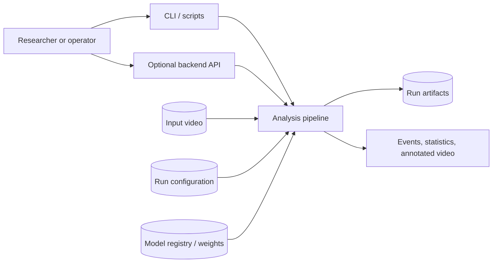
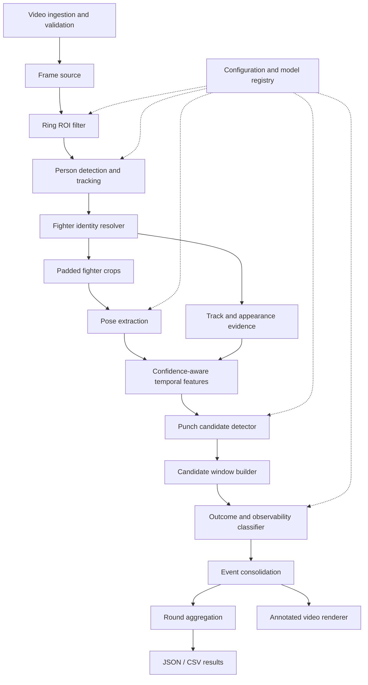
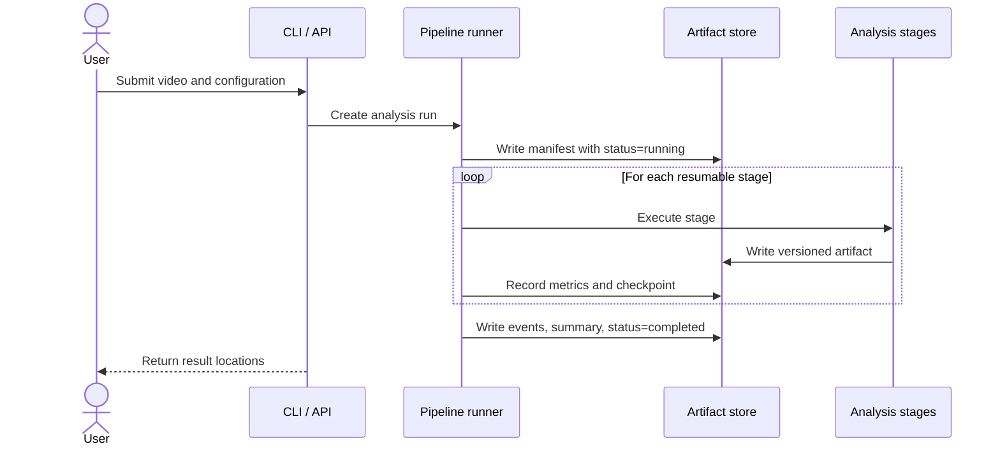

# Boxing Fight Analysis Architecture

## 1. Document status

This document describes the target architecture for the first working version
of Boxing Fight Analysis. It is an implementation guide, not a description of
features that already exist.

The repository is currently an early research prototype with a working web
application shell: FastAPI manages video uploads and persistent analysis-job
state, while a React dashboard operates those APIs. The vision pipeline and job
worker are not implemented yet. The components and interfaces below define how
the prototype should grow into a reproducible analysis system without coupling
the domain logic to a notebook, web framework, or a specific model
implementation.

## 2. Purpose and scope

The system processes one RGB video of one boxing round and produces:

- timestamped punch-attempt events for two selected fighters;
- an outcome for each observable attempt: `landed`, `blocked`, or `missed`;
- `unobservable` when the video does not contain enough evidence;
- per-fighter attempt and landed-punch totals;
- machine-readable artifacts and, optionally, an annotated video.

The first version is an offline batch-processing system. It assumes:

- one continuous round with no replays or scene cuts;
- one camera view;
- exactly two fighters;
- a manually defined ring region and manual fighter initialization;
- `blocked` and `parried` are one outcome class;
- event timestamps and counts matter more than real-time latency.

Automatic round detection, punch-type classification, judging, scoring, live
inference, and arbitrary broadcast-video support are outside the first-version
boundary.

## 3. Architectural principles

### 3.1 Event-centred processing

A punch is a temporal event, not a property of an isolated frame. Frame-level
detections and poses are intermediate evidence. Evaluation and user-facing
results operate on complete punch attempts.

### 3.2 Explicit uncertainty

Missing keypoints, occlusion, off-screen contact, low-confidence tracking, and
ambiguous outcomes must remain visible in the data. The pipeline must never
silently replace missing observations with confident predictions.

### 3.3 Stable fighter identity

Tracker IDs are implementation details and may change after an occlusion.
Downstream stages consume stable domain identities, `fighter_a` and
`fighter_b`, assigned by the fighter-identity component.

### 3.4 Replaceable model adapters

Detection, tracking, pose estimation, attempt detection, and outcome
classification are accessed through interfaces. Ultralytics YOLO and BoT-SORT
are initial adapters, not domain dependencies.

### 3.5 Reproducible stage artifacts

Every processing run records its input identity, configuration, model versions,
software version, and intermediate artifacts. Expensive upstream inference can
then be reused while developing downstream event models.

### 3.6 Interface-independent domain core

The analysis pipeline lives in a Python package. Notebooks, command-line tools,
and the backend call that package; they do not contain the core algorithms.

## 4. System context



The command line is the primary first-version interface because processing is
offline and long-running. The backend is a thin optional adapter for submitting
jobs and retrieving their status or results. It must not duplicate pipeline
logic.

## 5. Logical architecture



The implementation is a modular monolith: each stage is isolated behind a
small contract, but all stages can initially run in one Python process. This is
simpler to debug and deploy than distributed services and still allows heavy
stages to be moved to workers later.

## 6. Component responsibilities

### 6.1 Video ingestion

The ingestion component validates that the file can be decoded and records:

- a stable `video_id` and content checksum;
- frame rate, frame count, resolution, and duration;
- rotation and timing metadata;
- the selected round number;
- warnings for variable frame rate or decode failures.

All internal event boundaries use integer frame indices. Timestamps are derived
from the decoder time base when available, rather than assuming that
`frame_index / fps` is exact.

### 6.2 Ring-region filtering

The ring region is a polygon defined in source-frame coordinates and saved with
the run configuration. A person is eligible for fighter tracking when the
bottom-centre point of their bounding box lies inside that polygon.

The component filters candidates; it does not decide fighter identity. Keeping
these concerns separate prevents spectators and corner staff from increasing
the identity resolver's search space.

### 6.3 Person detection and multi-object tracking

This component returns all in-ring person tracks with bounding boxes,
confidence scores, and tracker-local IDs. The initial adapter may use a YOLO
person detector with BoT-SORT.

Tracking evidence should combine motion, bounding-box overlap, and appearance
features where available. Raw tracker output is retained because ID switches
are an important system metric.

### 6.4 Fighter identity resolution

On a clear initialization frame, the user selects the two fighters. The
identity resolver maps tracker-local IDs to stable `fighter_a` and `fighter_b`
identities throughout the round.

Resolution may use:

- spatial continuity and track history;
- appearance embeddings;
- clothing, headguard, and glove colour cues;
- explicit re-identification after gaps;
- an ambiguity score when the mapping is uncertain.

Frames with ambiguous identity are flagged and are not automatically assigned
to whichever detection is nearest.

### 6.5 Fighter crop generation

Each fighter bounding box is padded by a configurable margin, clipped to the
source frame, and passed to pose inference. The crop transform is recorded so
crop-space keypoints can be mapped exactly back to source-frame coordinates.

### 6.6 Pose extraction

The initial pose adapter uses a pretrained YOLO pose model. For every fighter
and frame it emits body keypoints with per-keypoint confidence.

Low-confidence keypoints are marked missing. Only short gaps may be
interpolated, and every interpolated value carries an interpolation flag. Long
gaps stay missing. Raw observations are kept separately from smoothed or
interpolated sequences.

### 6.7 Temporal feature extraction

The feature component converts tracks and poses into scale- and
position-normalized temporal signals, including:

- wrist velocity and acceleration;
- elbow angle and extension rate;
- wrist-to-shoulder distance;
- wrist direction relative to the opponent;
- wrist distance to opponent head, torso, wrists, and elbows;
- guard return motion;
- track, keypoint, and target-region visibility;
- crop clipping and occlusion indicators.

Features are calculated for each hand without assuming that one stance or one
camera orientation applies to every fight.

### 6.8 Punch-attempt candidate detection

The first implementation is a configurable rule-based baseline. It identifies
periods of extension toward the opponent followed by deceleration or guard
recovery. A later temporal model can implement the same interface.

The detector emits candidates rather than final events. Each candidate has a
start, peak/contact hypothesis, end, attacking fighter, hand when known, score,
and the evidence that triggered it.

### 6.9 Candidate window construction

For each candidate, this component extracts a configurable pre-event and
post-event time window containing both fighters' tracks, poses, visibility
masks, and optional RGB crops or optical-flow features. Windows are clipped at
video boundaries and record missing context explicitly.

### 6.10 Outcome and observability classification

The outcome classifier operates on the complete candidate window. It uses
temporal evidence such as glove trajectory, proximity to target regions,
defensive-arm intersection, target displacement, local optical flow, and
visibility.

Observability is evaluated before or jointly with outcome classification. When
the contact region is not sufficiently visible, the output is `unobservable`
regardless of which visible outcome has the highest raw score.

### 6.11 Event consolidation

Overlapping candidates from adjacent frames or duplicate hand signals are
merged into one attempt. Consolidation enforces domain invariants:

- one event has exactly one attacker and one defender;
- `start_frame <= contact_frame <= end_frame`;
- an event cannot simultaneously have multiple outcomes;
- one physical attempt is not counted twice;
- an unobservable event is an attempt but not a landed punch.

### 6.12 Aggregation and presentation

The aggregator groups events by round and fighter. Attempt totals include all
detected attempts, including unobservable ones; landed totals include only
events classified as `landed`. Coverage reports the proportion of attempts
with an observable outcome.

Presentation adapters write JSON and CSV and may render an annotated video.
Rendering consumes saved events and tracks so visualisation changes never alter
the analytical result.

## 7. Core data contracts

Contracts should be represented by typed Python models and serialized using a
versioned schema. Coordinates are floating-point source-frame pixels unless a
field explicitly states that it is normalized.

### 7.1 Frame observation

```json
{
  "schema_version": "1.0",
  "video_id": "fight_001",
  "frame_index": 426,
  "timestamp_ms": 14214,
  "fighter_id": "fighter_a",
  "tracker_id": 7,
  "bbox_xyxy": [312.4, 106.1, 594.7, 691.3],
  "track_confidence": 0.93,
  "identity_confidence": 0.88,
  "keypoints": {
    "left_wrist": {
      "x": 511.2,
      "y": 274.8,
      "confidence": 0.81,
      "visibility": "observed"
    }
  }
}
```

Valid keypoint visibility values are `observed`, `interpolated`, and `missing`.
A missing keypoint has no fabricated coordinates.

### 7.2 Punch candidate

```json
{
  "candidate_id": "cand_000184",
  "video_id": "fight_001",
  "attacker": "fighter_a",
  "defender": "fighter_b",
  "hand": "left",
  "start_frame": 418,
  "contact_frame": 426,
  "end_frame": 437,
  "attempt_score": 0.84,
  "trigger": "rule_baseline_v1"
}
```

`hand` may be `left`, `right`, or `unknown`. The contact frame at this stage is
a hypothesis and may be refined by the outcome classifier.

### 7.3 Final punch event

```json
{
  "schema_version": "1.0",
  "event_id": "evt_000137",
  "video_id": "fight_001",
  "round": 1,
  "attacker": "fighter_a",
  "defender": "fighter_b",
  "hand": "left",
  "start_frame": 418,
  "contact_frame": 426,
  "end_frame": 437,
  "start_ms": 13947,
  "contact_ms": 14214,
  "end_ms": 14581,
  "outcome": "blocked",
  "observable": true,
  "attempt_confidence": 0.84,
  "outcome_confidence": 0.76,
  "quality_flags": [],
  "model_versions": {
    "attempt": "rule_baseline_v1",
    "outcome": "temporal_outcome_v1"
  }
}
```

The `outcome` values are `landed`, `blocked`, `missed`, and `unobservable`.
`observable` must be `false` when the outcome is `unobservable`, and
`outcome_confidence` may be omitted. Quality flags can include `identity_gap`,
`target_occluded`, `crop_clipped`, `low_pose_confidence`, and
`insufficient_context`.

### 7.4 Round summary

```json
{
  "video_id": "fight_001",
  "round": 1,
  "fighters": {
    "fighter_a": {
      "attempts": 31,
      "landed": 18,
      "blocked": 7,
      "missed": 4,
      "unobservable": 2
    },
    "fighter_b": {
      "attempts": 27,
      "landed": 14,
      "blocked": 6,
      "missed": 5,
      "unobservable": 2
    }
  },
  "observable_coverage": 0.931
}
```

## 8. Processing lifecycle



Each run has a generated `run_id`. A run is immutable after completion. Reruns
with new settings receive a new ID and may reference compatible artifacts from
an earlier run.

Recommended run states are `queued`, `running`, `completed`, `failed`, and
`cancelled`. A failure records its stage and error without presenting partial
statistics as a completed result.

## 9. Artifact layout

Generated files should not be committed to Git. A local artifact store can use:

```text
artifacts/
└── <video_id>/
    └── <run_id>/
        ├── manifest.json
        ├── config.resolved.yaml
        ├── video_metadata.json
        ├── tracks.parquet
        ├── poses.parquet
        ├── features.parquet
        ├── candidates.jsonl
        ├── events.jsonl
        ├── summary.json
        ├── metrics.json
        ├── logs/
        └── annotated.mp4
```

Tabular frame-level data belongs in Parquet for typed, compact storage. Event
records use JSON Lines for easy inspection and streaming. Small summaries and
manifests use JSON.

The manifest contains at least:

- input checksum and video metadata;
- resolved configuration;
- Git commit and schema version;
- Python and dependency versions;
- model names, checksums, and thresholds;
- stage timings, warnings, and artifact paths;
- random seeds where applicable.

## 10. Configuration and model registry

Configuration is loaded once at the application boundary, validated, and
passed explicitly to components. Algorithms must not read global environment
variables or hidden notebook state.

Configuration groups should include:

- video and round metadata;
- ring polygon and fighter initialization;
- detector, tracker, and pose settings;
- crop padding and keypoint confidence thresholds;
- maximum interpolation gap;
- feature-window sizes;
- punch candidate thresholds;
- outcome and observability thresholds;
- artifact and rendering options.

Model weights are addressed through a model registry entry containing a logical
name, local or remote location, checksum, task, expected input, and version.
Large weights should normally be downloaded or managed as release artifacts
rather than stored directly in Git.

## 11. Proposed repository structure

```text
Boxing-fight-analysis/
├── backend/
│   └── app/
│       ├── main.py                 # Optional API application factory
│       ├── routes.py               # Job and result endpoints
│       └── schemas.py              # API-only request/response models
├── configs/
│   ├── default.yaml
│   ├── tracking.yaml
│   └── models.yaml
├── data/
│   ├── annotations/                # Versioned event labels, no raw footage
│   └── samples/                    # Only legally distributable samples
├── models/                         # Local weights; ignored when practical
├── notebooks/                      # Exploration, not production logic
├── scripts/
│   ├── run_inference.py
│   ├── extract_features.py
│   └── evaluate.py
├── src/boxing_analysis/
│   ├── domain/
│   │   ├── models.py               # Typed core contracts
│   │   └── enums.py
│   ├── ingestion.py
│   ├── roi.py
│   ├── detection.py
│   ├── tracking.py
│   ├── identity.py
│   ├── crops.py
│   ├── pose.py
│   ├── features.py
│   ├── attempts.py
│   ├── outcomes.py
│   ├── consolidation.py
│   ├── aggregation.py
│   ├── rendering.py
│   ├── artifacts.py
│   ├── pipeline.py                 # Stage orchestration
│   └── adapters/                   # Ultralytics, OpenCV, tracker adapters
├── tests/
│   ├── unit/
│   ├── integration/
│   └── fixtures/
├── ARCHITECTURE.md
├── README.md
└── pyproject.toml
```

Dependencies flow inward: interfaces and adapters depend on the domain and
pipeline contracts, while the domain does not import FastAPI, OpenCV,
Ultralytics, or storage-specific code.

## 12. Backend boundary

The backend management API intentionally remains small:

- create an analysis job from a local/uploaded video and configuration;
- read job status and stage progress;
- retrieve the run manifest, events, summary, and artifact links;
- cancel a queued or running job when cancellation is supported.

Long processing must not run inside an HTTP request handler. The handler
creates a job and delegates execution to a worker or local job runner. Input
paths, uploads, and artifact paths must be validated to prevent access outside
configured storage roots.

## 13. Failure and uncertainty handling

Failures fall into three categories:

1. **Fatal run errors** — unreadable input, incompatible model, corrupt
   configuration, or inability to write required artifacts. The run becomes
   `failed`.
2. **Recoverable frame errors** — an isolated decode failure, missed detection,
   or unavailable pose. The frame is marked missing and processing continues.
3. **Analytical uncertainty** — ambiguous identity, occluded contact, or weak
   evidence. The event receives quality flags or becomes `unobservable`; this
   is not a software failure.

Warnings are structured and include the stage, frame range, fighter when
applicable, and a stable warning code.

## 14. Testing strategy

### Unit tests

Unit tests cover coordinate transforms, ring inclusion, keypoint masking and
gap interpolation, temporal features, candidate merging, event invariants, and
round aggregation. These tests use synthetic arrays and do not load ML models.

### Contract tests

Every adapter is tested against shared contracts: expected coordinate space,
confidence range, missing-value semantics, deterministic ordering, and schema
serialization.

### Integration tests

A short, legally distributable fixture video exercises decoding through result
generation. Model-heavy tests are marked separately so the default test suite
remains fast.

### Regression tests

Pinned fixture clips and annotations detect changes in candidate counts,
timestamps, outcomes, and pose coverage. Numeric tolerances are explicit to
avoid fragile pixel-perfect comparisons.

### Evaluation tests

Dataset splits are made by fight, never by random frame. Primary metrics are:

- event precision, recall, and F1 with a documented temporal match rule;
- false attempts per minute and round-count mean absolute error;
- macro-F1 and per-class metrics for observable outcomes;
- landed-count mean absolute error and observable coverage;
- tracker ID switches and usable-pose coverage;
- processing time per minute of source video.

## 15. Performance and scaling

The first implementation processes one video per process and batches model
inference where GPU memory permits. Frames should stream through the expensive
vision stages rather than loading an entire video into memory. Compact stage
artifacts allow later stages to work without decoding the video again.

The main scale boundary is the analysis job. Independent videos can be assigned
to separate worker processes or machines without changing the domain package.
Within one job, deterministic frame ordering is preserved even if inference is
batched.

## 16. Data governance and safety

Raw fight footage may be copyrighted or personally sensitive and is not
committed to the repository. The project stores only footage that can legally
be used, with provenance and licence information for distributable samples.

Train, validation, and test partitions must be recorded and split by fight to
avoid appearance and venue leakage. Manual labels retain annotator, revision,
and review metadata. Predicted landed-punch totals are analytical estimates,
not official judging results.

## 17. Implementation sequence

The architecture can be delivered incrementally:

1. Create the package, typed contracts, validated configuration, artifact
   manifest, and CLI runner.
2. Implement video ingestion, ring ROI filtering, person tracking, and manual
   fighter initialization.
3. Add padded crops, pose extraction, confidence masking, and saved pose
   sequences.
4. Implement normalized features and the rule-based punch-attempt baseline.
5. Add event consolidation, JSON/CSV output, aggregation, and annotated video.
6. Build the annotation and fight-level evaluation workflow.
7. Replace rule components with temporal attempt and outcome models while
   keeping their contracts stable.
8. Connect the existing backend job API to background pipeline execution after
   the local pipeline is reproducible.

This order produces inspectable results early and keeps model research
independent from application delivery.

## 18. Architecture decisions summary

| Decision | Rationale |
| --- | --- |
| Offline batch processing first | Matches the research workflow and avoids premature real-time constraints. |
| Modular monolith | Simple local execution with clear boundaries and a path to workers later. |
| Event-level domain model | Punches require temporal context and event-level evaluation. |
| Stable fighter IDs separate from tracker IDs | Tracker IDs may switch during overlap or occlusion. |
| Observability is a first-class result | The system must not guess when visual evidence is absent. |
| Versioned, resumable artifacts | Vision inference is expensive and downstream experiments change frequently. |
| Core package independent of API and notebooks | Enables CLI, tests, backend jobs, and research tools to share one implementation. |
| Fight-level dataset splits | Prevents leakage from backgrounds, camera positions, and fighter appearance. |
